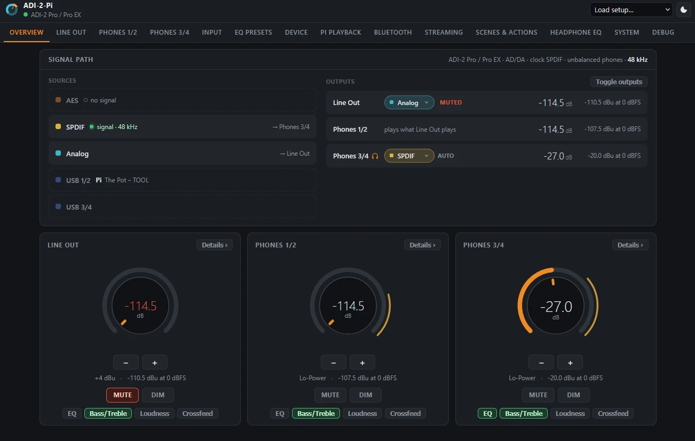
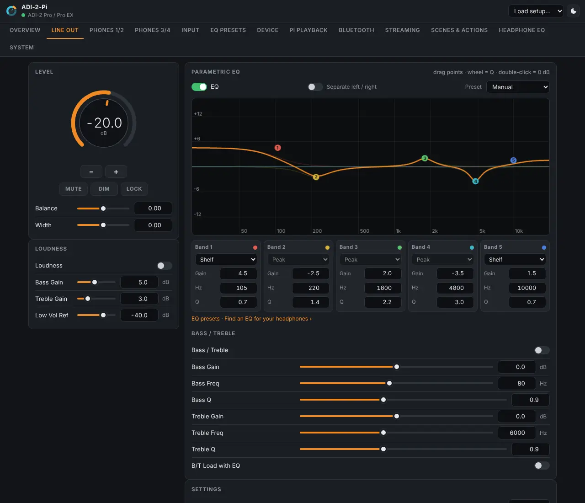
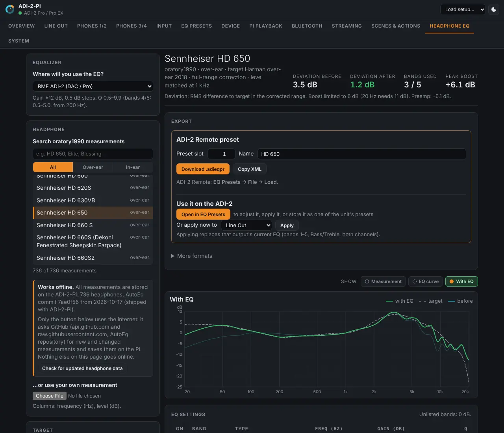

Network remote and audio bridge for RME ADI-2 converters (ADI-2 DAC, ADI-2 Pro / Pro EX, ADI-2/4
Pro SE / Pro EX). Runs on a Raspberry Pi connected to the unit by USB, or on another Linux computer.

- **Web interface** for every output, input and device setting: parametric EQ with a draggable
  curve, the unit's 20 EQ presets, setups. Works offline, on phones too.
- **API** (WebSocket, HTTP) for the Stream Deck plugin and other apps ([docs/API.md](docs/API.md));
  **MQTT** with Home Assistant discovery.
- **Bluetooth both ways:** phones play into the ADI-2; Bluetooth headphones get Line Out or
  Phones 3/4 after its EQ (LDAC, aptX HD, aptX, SBC).
- **Network receivers:** AirPlay (2), Spotify Connect, UPnP/DLNA, Squeezelite, Snapcast, Roon Bridge.
- **Volume safety:** limits, rise speed, linked outputs, start volume; volume from the AirPlay or
  Spotify sender.
- **Scenes, actions, sleep timer, input priority, headphone profiles.**
- **Headphone EQ Generator:** a parametric EQ for your headphones from oratory1990's measurements
  ([docs/eq-generator.md](docs/eq-generator.md)).
- **Shutdown with the ADI-2** (USB or its 12 V trigger, which also starts the Pi again), UPS HAT,
  backup, access key, signed updates from the page.



<p>


</p>

## Requirements

- Raspberry Pi with Raspberry Pi OS Bookworm or Trixie (64-bit recommended; tested on a Pi 4), or
  another computer with Debian 12+, Ubuntu 22.04+ or Linux Mint.
- The ADI-2 on USB with **MIDI Control = ON** (Pro models: SETUP – Options – Device Mode; DAC:
  Remap Keys / Diag), in USB stereo mode (the default) for Bluetooth and streaming.

## Installation

```sh
git clone https://github.com/shells-dw/adi2-pi.git
cd adi2-pi
sudo ./install.sh
```

Then open the address it prints, e.g. `http://raspberrypi.local`. Running it again updates and
keeps the settings. Common options:

| Option | |
|---|---|
| `--no-bluetooth` | remote control only (no audio, Bluetooth, streaming) |
| `--with-airplay2`, `--with-spotify`, `--with-roon` | the optional receivers |
| `--with-ups` | Waveshare UPS HAT |
| `--port N` | another port than 80 |

All options: [docs/install.md](docs/install.md).

**Other Linux systems:** on Debian, Ubuntu and Mint the installer asks whether the computer is
used only for the ADI-2 (full installation) or also otherwise (remote control only; the desktop
keeps its sound and Bluetooth). Other distributions: [set up by hand](docs/install.md#other-linux-systems).

**Updates:** System → *ADI-2-Pi updates* (from GitHub or from a file, signed releases only), or
unpack a [release](https://github.com/shells-dw/adi2-pi/releases) and run
`sudo ./install.sh --same-options`.

## Documentation

- [User guide](docs/guide.md): every feature, [wiring the 12 V trigger](docs/guide.md#wiring-the-12-v-trigger),
  [UPS HAT](docs/guide.md#ups-hat)
- [Installation and updates](docs/install.md)
- [API](docs/API.md) · [Headphone EQ Generator](docs/eq-generator.md) · [Development and protocol](docs/development.md)

## Troubleshooting

```sh
journalctl -u adi2-pi -f            # bridge log
journalctl -u adi2-pi-audio -n 50   # audio service
cat /proc/asound/cards              # ADI-2 present?
```

| Message | Cause / action |
|---|---|
| `no ADI-2 found` | USB connection; try another port. |
| `does not answer` | MIDI Control is off: SETUP – Options – Device Mode – MIDI Control = ON. |
| `busy` | Another program has the MIDI port open (a desktop session's PipeWire; run the installer again). |
| A setting changes unexpectedly | Debug tab → *Sent to the unit* lists every change and its origin. |
| `no Bluetooth adapter found` | `dtoverlay=disable-bt` in `/boot/firmware/config.txt`? `sudo rfkill unblock bluetooth`. |
| Bluetooth headphones silent | Bluetooth source is *off*, or that output is muted before its DSP. |
| Trigger: `GPIO3 is in use` | I²C is on (UPS HAT): choose another *Trigger input*. |
| Access key forgotten | Remove `"access"` from `/var/lib/adi2-pi/settings.json`, `sudo systemctl restart adi2-pi`. |

## Support

If ADI-2-Pi is useful to you: [](https://ko-fi.com/dwshells) [](https://www.buymeacoffee.com/dwshells)

## License

GPL-3.0-or-later, see [LICENSE](LICENSE). Third-party content: [NOTICE.md](NOTICE.md).

RME, ADI-2 and TotalMix are trademarks of RME Intelligent Audio Solutions / Audio AG. This
project is not affiliated with RME.
